# Fashion MNIST 모델 선택 및 평가 보고서

실험 완료 | 2026-11-04 16:54 KST

모델 선택/튜닝 실험: 48회. 모델과 설정의 선택에는 검증 데이터만 사용했다.

선택 완료 후 고정한 대표 체크포인트를 테스트 10,000개로 평가했다. 테스트 정확도는 93.29%로 93% 기준을 충족했다. 최종 ablation은 아직 수행하지 않았다.

선택 모델: vgg. 3개 학습 시드의 검증 정확도 평균 93.77%, 표본 표준편차 0.42%p.

검증 정확도 94% 목표: 3시드 평균 기준 미달. 대표 seed 42 저장 모델은 94.06%이며, 평균과 단일 실행 성능을 구분한다.

## 1. 데이터와 실행 조건

| 항목 | 내용 |
| --- | --- |
| 학습 / 검증 / 테스트 | 55,000 / 5,000 / 10,000 (선택 완료 후 평가) |
| 분할 시드 / 탐색 시드 | 42 / 42; 반복 검증 시 43, 44 추가 |
| 학습 픽셀 mean / population std | 0.2855656942 / 0.3527285865 |
| 평균/표준편차 산정 범위 | 학습 subset의 43,120,000개 픽셀만 사용 |
| Optimizer / epoch / Early Stopping | Adam / 최대 100 / patience=10, delta=0.00001 |
| GPU | NVIDIA GeForce RTX 3060 8 GB |
| 선택 기준 | 검증 loss로 저장된 체크포인트를 재평가한 검증 정확도 |
| W&B | cnn_fashion_mnist 프로젝트; 각 실행 링크를 아래에 제시 |

기존 b_fashion_mnist_train.py와 원본 Trainer를 사용했다. 별도 실행 스크립트가 기록 수집을 담당한다. 제공 데이터 함수의 분할과 DataLoader를 유지하고, ToTensor의 CPU float32/255 결과를 GPU에 캐시했다. 캐시와 원본 픽셀의 일치를 확인했으며 데이터 수를 줄이거나 배치를 생략하지 않았다.

모델별 조정: CNN의 입력 채널을 1로, 첫 FC 입력을 256으로 변경했다. VGG는 32×32 resize, NiN은 기존 GAP, GoogLeNet은 주 경로에 Linear(1024,10) 추가, ResNet은 기존 구조를 사용한다. 원래 BN이 없는 모델의 초기 비교에서는 BN을 추가하지 않았다.

## 2. 탐색 방법

초기 비교는 다섯 모델을 batch=128, LR=0.001, weight decay=0.0001, augmentation 없음으로 실행한다. 유력한 두 모델에서 batch 64/128/256 × LR 0.0003/0.001/0.003을 탐색하고, 상위 두 조합에서 weight decay 0/0.0001/0.001을 비교한다. 이후 augmentation과 Dropout 0/0.2/0.5를 비교하고, 필요 시 원래 BN이 없는 후보에 BN을 추가해 튜닝한다. 최종 후보는 학습 시드 42/43/44에서 반복 확인한다.

이는 단계적 탐색이며 모든 조합의 전역 최적값을 보장하지 않는다. 단일 초기 학습률에서 탈락한 모델의 잠재적 성능을 배제하지 않는다. batch size가 달라도 최대 epoch와 Early Stopping 조건은 동일하므로 optimizer update 수는 다르다.

## 3. 실제 실행 결과

| ID | 모델 | Batch | LR | WD | BN | Drop | Aug | Seed | Val % | Epoch |
| --- | --- | --- | --- | --- | --- | --- | --- | --- | --- | --- |
| E01 | cnn | 128 | 0.001 | 0.0001 | 1 | 0.5 | 0 | 42 | 89.58 | 65 |
| E02 | googlenet | 128 | 0.001 | 0.0001 | 0 | 0.5 | 0 | 42 | 90.02 | 19 |
| E03 | nin | 128 | 0.001 | 0.0001 | 0 | 0.5 | 0 | 42 | 91.40 | 39 |
| E04 | resnet | 128 | 0.001 | 0.0001 | 1 | 0 | 0 | 42 | 90.52 | 18 |
| E05 | vgg | 128 | 0.001 | 0.0001 | 0 | 0.5 | 0 | 42 | 91.88 | 24 |
| E06 | nin | 64 | 0.0003 | 0.0001 | 0 | 0.5 | 0 | 42 | 90.30 | 34 |
| E07 | nin | 64 | 0.001 | 0.0001 | 0 | 0.5 | 0 | 42 | 91.18 | 45 |
| E08 | nin | 64 | 0.003 | 0.0001 | 0 | 0.5 | 0 | 42 | 10.96 | 11 |
| E09 | nin | 128 | 0.0003 | 0.0001 | 0 | 0.5 | 0 | 42 | 90.86 | 50 |
| E10 | nin | 128 | 0.003 | 0.0001 | 0 | 0.5 | 0 | 42 | 10.96 | 11 |
| E11 | nin | 256 | 0.0003 | 0.0001 | 0 | 0.5 | 0 | 42 | 90.22 | 56 |
| E12 | nin | 256 | 0.001 | 0.0001 | 0 | 0.5 | 0 | 42 | 90.98 | 36 |
| E13 | nin | 256 | 0.003 | 0.0001 | 0 | 0.5 | 0 | 42 | 91.20 | 51 |
| E14 | vgg | 64 | 0.0003 | 0.0001 | 0 | 0.5 | 0 | 42 | 91.98 | 18 |
| E15 | vgg | 64 | 0.001 | 0.0001 | 0 | 0.5 | 0 | 42 | 91.32 | 25 |
| E16 | vgg | 64 | 0.003 | 0.0001 | 0 | 0.5 | 0 | 42 | 10.18 | 18 |
| E17 | vgg | 128 | 0.0003 | 0.0001 | 0 | 0.5 | 0 | 42 | 91.96 | 18 |
| E18 | vgg | 128 | 0.003 | 0.0001 | 0 | 0.5 | 0 | 42 | 91.22 | 37 |
| E19 | vgg | 256 | 0.0003 | 0.0001 | 0 | 0.5 | 0 | 42 | 92.12 | 22 |
| E20 | vgg | 256 | 0.001 | 0.0001 | 0 | 0.5 | 0 | 42 | 92.38 | 22 |
| E21 | vgg | 256 | 0.003 | 0.0001 | 0 | 0.5 | 0 | 42 | 10.20 | 23 |
| E22 | nin | 256 | 0.0003 | 0 | 1 | 0.5 | 1 | 42 | 93.34 | 34 |
| E23 | nin | 256 | 0.001 | 0 | 1 | 0.5 | 1 | 42 | 93.32 | 32 |
| E24 | nin | 256 | 0.003 | 0 | 1 | 0.5 | 1 | 42 | 93.98 | 40 |
| E25 | vgg | 256 | 0.0003 | 0.0001 | 1 | 0 | 1 | 42 | 94.06 | 35 |
| E26 | vgg | 256 | 0.001 | 0.0001 | 1 | 0 | 1 | 42 | 93.78 | 44 |
| E27 | nin | 256 | 0.003 | 0 | 0 | 0 | 0 | 42 | 90.80 | 25 |
| E28 | nin | 256 | 0.003 | 0 | 0 | 0.5 | 1 | 42 | 92.08 | 71 |
| E29 | nin | 256 | 0.003 | 0 | 0 | 0 | 1 | 42 | 91.94 | 47 |
| E30 | nin | 256 | 0.003 | 0 | 0 | 0.2 | 0 | 42 | 91.26 | 28 |
| E31 | nin | 256 | 0.003 | 0 | 0 | 0.2 | 1 | 42 | 90.92 | 48 |
| E32 | vgg | 256 | 0.001 | 0.0001 | 0 | 0.2 | 0 | 42 | 91.82 | 18 |
| E33 | vgg | 256 | 0.001 | 0.0001 | 0 | 0.5 | 1 | 42 | 92.64 | 35 |
| E34 | vgg | 256 | 0.001 | 0.0001 | 0 | 0 | 0 | 42 | 92.12 | 22 |
| E35 | vgg | 256 | 0.001 | 0.0001 | 0 | 0 | 1 | 42 | 93.46 | 37 |
| E36 | vgg | 256 | 0.001 | 0.0001 | 0 | 0.2 | 1 | 42 | 93.16 | 46 |
| E37 | nin | 256 | 0.003 | 0 | 1 | 0.5 | 1 | 43 | 94.06 | 43 |
| E38 | nin | 256 | 0.003 | 0 | 1 | 0.5 | 1 | 44 | 85.46 | 42 |
| E39 | vgg | 256 | 0.0003 | 0.0001 | 1 | 0 | 1 | 43 | 93.96 | 40 |
| E40 | vgg | 256 | 0.0003 | 0.0001 | 1 | 0 | 1 | 44 | 93.28 | 30 |
| E41 | nin | 128 | 0.001 | 0 | 0 | 0.5 | 0 | 42 | 91.82 | 27 |
| E42 | nin | 128 | 0.001 | 0.001 | 0 | 0.5 | 0 | 42 | 9.86 | 15 |
| E43 | nin | 256 | 0.003 | 0.001 | 0 | 0.5 | 0 | 42 | 9.52 | 11 |
| E44 | nin | 256 | 0.003 | 0 | 0 | 0.5 | 0 | 42 | 92.02 | 36 |
| E45 | vgg | 256 | 0.0003 | 0 | 0 | 0.5 | 0 | 42 | 91.96 | 19 |
| E46 | vgg | 256 | 0.0003 | 0.001 | 0 | 0.5 | 0 | 42 | 9.52 | 12 |
| E47 | vgg | 256 | 0.001 | 0 | 0 | 0.5 | 0 | 42 | 92.18 | 20 |
| E48 | vgg | 256 | 0.001 | 0.001 | 0 | 0.5 | 0 | 42 | 9.52 | 12 |

현재 최고 단일 실행: vgg, 저장 체크포인트 검증 정확도 94.06%. 학습 중 최고 정확도 94.36%와 구분한다.

### 초기 모델 비교 해석

완료된 초기 비교 중 vgg이 91.88%로 가장 높고, nin이 91.40%로 뒤를 이었다. 이는 동일 학습률에서 원본에 가까운 서로 다른 모델 구성을 비교한 결과다. 구조 하나만의 인과 효과나 각 모델의 최적 성능 순위로 해석하지 않는다.

### 모델별 튜닝 결과 해석

nin: 현재 좋은 단일 설정은 batch=256, LR=0.003, WD=0.0, BN=1, Dropout=0.5, augmentation=True이며 저장 모델 검증 정확도는 93.98%다. 초기 설정 대비 +2.58%p 차이다. 여러 설정이 달라졌으므로 이 차이를 특정 기법 하나의 기여도로 해석하지 않는다.

vgg: 현재 좋은 단일 설정은 batch=256, LR=0.0003, WD=0.0001, BN=1, Dropout=0, augmentation=True이며 저장 모델 검증 정확도는 94.06%다. 초기 설정 대비 +2.18%p 차이다. 여러 설정이 달라졌으므로 이 차이를 특정 기법 하나의 기여도로 해석하지 않는다.

## 4. 최종 후보의 반복 검증

| 모델 | seed 42 / 43 / 44 (%) | 평균 (%) | 표본 표준편차 (%p) |
| --- | --- | --- | --- |
| vgg | 94.06 / 93.96 / 93.28 | 93.77 | 0.42 |
| nin | 93.98 / 94.06 / 85.46 | 91.17 | 4.94 |

최종 설정과 대표 체크포인트는 다음과 같다. 대표 파일은 선택 모델의 seed 42 실행이며, 가장 잘 나온 시드만 골라 성능을 주장하지 않는다.

| 설정 | 값 |
| --- | --- |
| batch_size | 256 |
| epochs | 100 |
| learning_rate | 0.0003 |
| validation_intervals | 1 |
| early_stop_patience | 10 |
| early_stop_delta | 1e-05 |
| optimizer | 3 |
| weight_decay | 0.0001 |
| dropout | False |
| normalization | 1 |
| augment | True |
| model | vgg |
| dropout_rate | 0.5 |
| normalize | True |
| mean | 0.2855656942074541 |
| std | 0.3527285864947437 |
| seed | 42 |
| split_seed | 42 |

`/home/link/link_dl/_03_homeworks/homework_3/experiments/normalization_tuning_vgg_edb82afd29c0/cnn_fashion_mnist_vgg_bn1_drop0_aug1_norm1_seed42_checkpoint_latest.pt`

### 고찰과 제한

모델 선택/튜닝 표의 정확도는 고정된 검증 분할에 대한 값이다. 반복적인 튜닝으로 검증 분할에 과적합될 수 있으므로 별도로 고정한 대표 체크포인트의 테스트 결과와 구분한다. GoogLeNet의 학습/검증 loss에는 주 loss + 0.3 × 두 보조 loss가 포함되어 다른 모델과 절대 loss 크기를 직접 비교하지 않는다. 검증 loss는 기존 Trainer의 배치 평균 방식이며 서로 다른 batch size의 절대 loss만으로 설정을 선택하지 않았다.

다음 단계는 선택된 설정을 고정한 후 최소 두 기법의 ablation을 수행하는 것이다. 문제 1의 입력 정규화 유무 비교와 작성자 본인의 숙제 후기는 아직 별도 작업으로 남아 있다.

## 5. 고정 모델의 테스트 평가 (문제 3)

대표 VGG 체크포인트를 strict=True로 복원했으며, 테스트 접근 전에 검증 5,000개 정확도 94.06%를 재현했다. 입력은 32x32로 resize한 뒤 학습 mean/std로 정규화했다. 추론에는 augmentation을 적용하지 않았고 model.eval()/inference_mode()를 사용했다. 제공 테스트 로더의 전체 배치를 256개씩 나눠 처리했다.

| 항목 | 결과 |
| --- | --- |
| Test accuracy | 93.29% |
| 정답 / 오답 / 전체 | 9329 / 671 / 10000 |
| 93% 기준 | 충족 |
| 검증 정확도 - 테스트 정확도 | 0.77%p |
| 추론 전후 BN 통계 | 동일함 |

Precision은 해당 클래스로 예측한 샘플 중 정답 비율 TP/(TP+FP), recall은 실제 해당 클래스 샘플 중 찾아낸 비율 TP/(TP+FN)이다. F1은 precision과 recall의 조화평균이다. 분모가 0인 경우에는 0으로 처리했다.

| Class | Precision % | Recall % | F1 % | Support |
| --- | --- | --- | --- | --- |
| T-shirt/top | 86.26 | 91.00 | 88.56 | 1000 |
| Trouser | 99.60 | 99.00 | 99.30 | 1000 |
| Pullover | 89.07 | 90.50 | 89.78 | 1000 |
| Dress | 92.07 | 94.10 | 93.08 | 1000 |
| Coat | 88.82 | 90.60 | 89.70 | 1000 |
| Sandal | 99.09 | 98.40 | 98.75 | 1000 |
| Shirt | 84.75 | 75.60 | 79.92 | 1000 |
| Sneaker | 96.36 | 97.90 | 97.12 | 1000 |
| Bag | 98.80 | 98.70 | 98.75 | 1000 |
| Ankle boot | 97.78 | 97.10 | 97.44 | 1000 |
| Macro avg | 93.26 | 93.29 | 93.24 | 10000 |
| Weighted avg | 93.26 | 93.29 | 93.24 | 10000 |

각 클래스의 support가 1,000개로 동일하므로 macro 평균과 weighted 평균은 이 결과에서 같다.

### 테스트 혼동행렬: 원시 개수

양방향 혼동이 가장 많은 쌍은 T-shirt/top와 Shirt로 162개다. 단방향 최대는 Shirt를 T-shirt/top로 예측한 118개다.

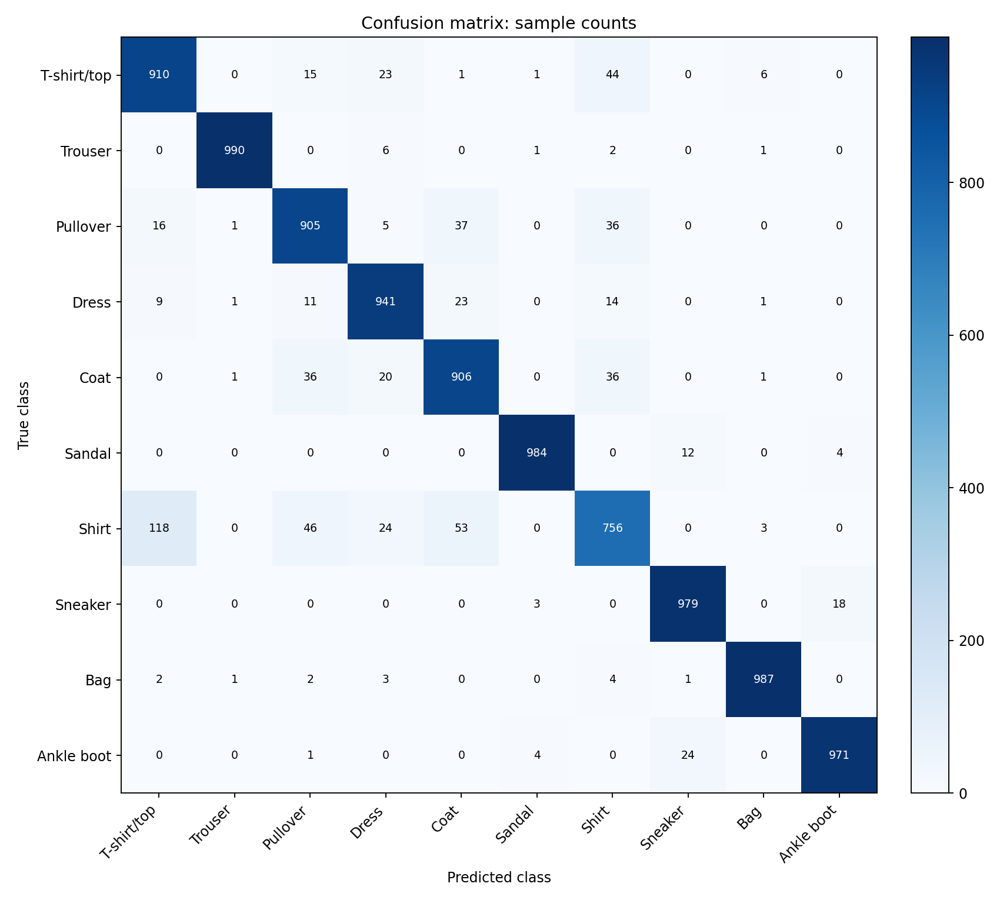

세로축은 정답, 가로축은 예측 클래스다. 행별 비율 그림의 대각선은 각 클래스 recall에 해당한다.

### 테스트 혼동행렬: 행별 비율

양방향 혼동이 가장 많은 쌍은 T-shirt/top와 Shirt로 162개다. 단방향 최대는 Shirt를 T-shirt/top로 예측한 118개다.

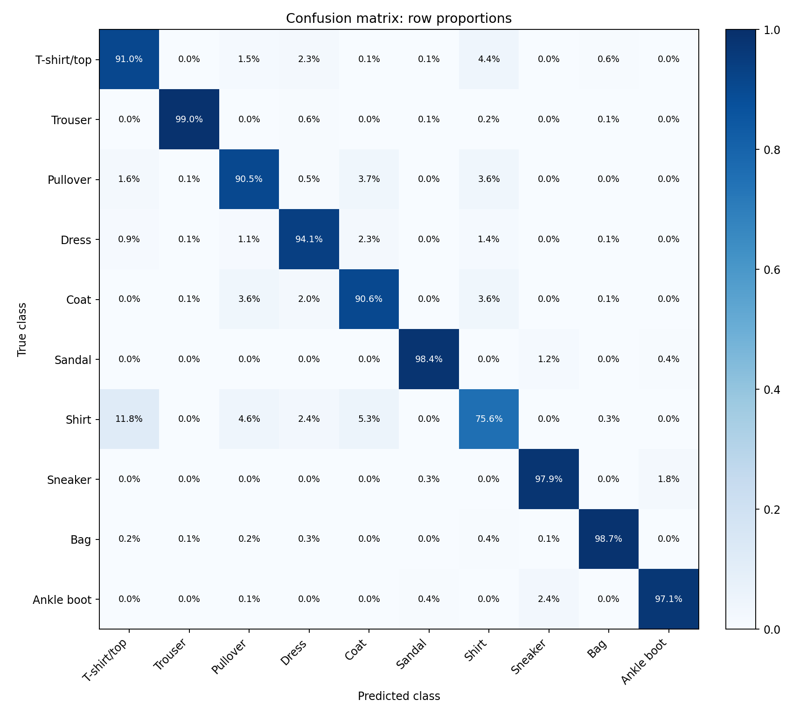

세로축은 정답, 가로축은 예측 클래스다. 행별 비율 그림의 대각선은 각 클래스 recall에 해당한다.

### 낮은 클래스 지표와 실제 오분류 분석

최저 precision은 Shirt 84.75%, 최저 recall은 Shirt 75.60%다. Shirt 정답 샘플 1000개 중 244개를 다른 클래스로 분류했다.

아래는 가장 낮은 recall 클래스의 오분류 중 테스트 index 순으로 앞의 10개다. 무작위 10개 예측 결과와는 별도의 분석용 사례다.

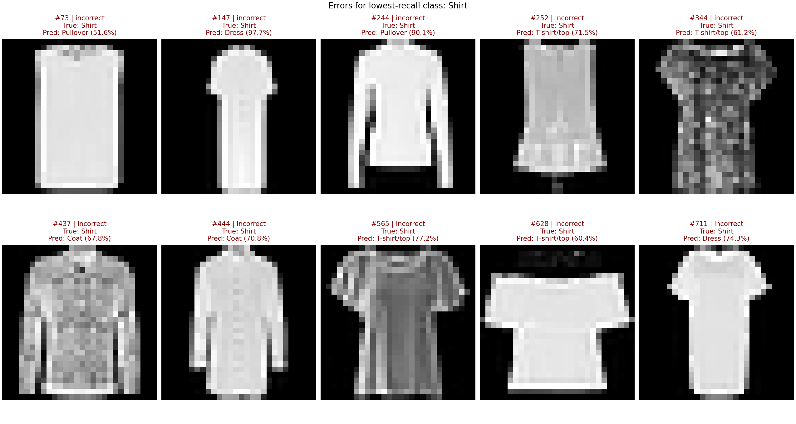

관찰: Shirt를 T-shirt/top, Pullover, Coat 등으로 예측한 사례가 보이고, Dress로 예측한 사례도 있다. 추정: 상의의 전체 윤곽이 겹치고 28x28 해상도에서는 깃/여밈 등 세부 특징이 약해지는 것이 혼동의 원인일 수 있다. 이는 사례 관찰을 바탕으로 한 추정이며, 데이터의 레이블 오류나 특정 원인을 확정한 것은 아니다.

| 확신도 기준 | 정분류 | 오분류 |
| --- | --- | --- |
| 0.9 이상 | 8401 | 168 |
| 0.9 미만 | 928 | 503 |

고확신 오분류도 존재하므로 큰 softmax 값이 정답을 보장하지 않는다. 0.9는 사전에 정한 해석용 구분이며, 확률 보정을 검증한 기준은 아니다.

## 6. 무작위 테스트 이미지 10개 (문제 4)

예측 결과와 무관하게 sample_seed=42로 10개를 중복 없이 추출했다. 정답/오답 개수를 맞추기 위해 재추출하지 않았다.

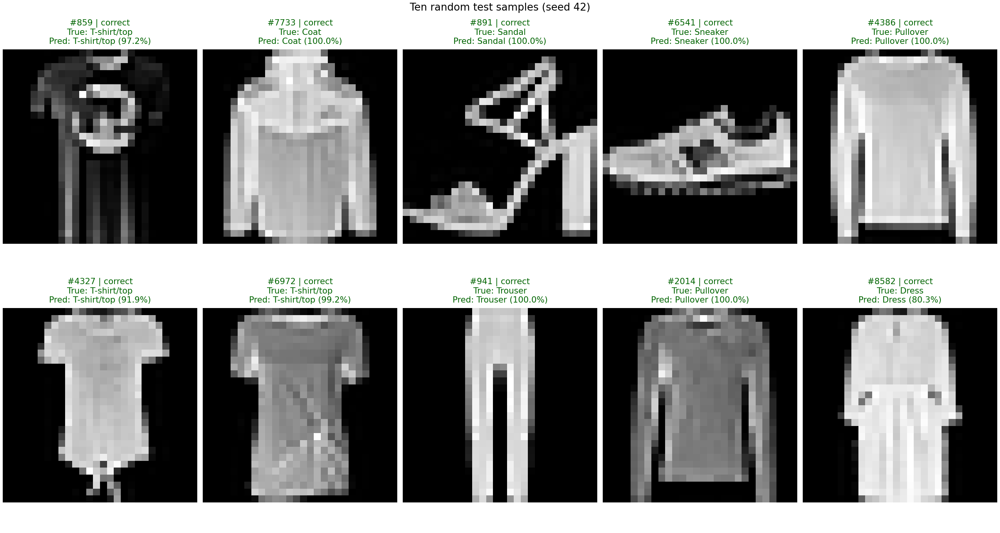

| Index | 정답 | 예측 | 정답 여부 | 확신도 % | 해석 |
| --- | --- | --- | --- | --- | --- |
| 859 | T-shirt/top | T-shirt/top | O | 97.2316 | 고확신 정분류 |
| 7733 | Coat | Coat | O | 99.9692 | 고확신 정분류 |
| 891 | Sandal | Sandal | O | 99.9958 | 고확신 정분류 |
| 6541 | Sneaker | Sneaker | O | 99.9882 | 고확신 정분류 |
| 4386 | Pullover | Pullover | O | 99.9737 | 고확신 정분류 |
| 4327 | T-shirt/top | T-shirt/top | O | 91.9330 | 고확신 정분류 |
| 6972 | T-shirt/top | T-shirt/top | O | 99.2120 | 고확신 정분류 |
| 941 | Trouser | Trouser | O | 99.9992 | 고확신 정분류 |
| 2014 | Pullover | Pullover | O | 99.9509 | 고확신 정분류 |
| 8582 | Dress | Dress | O | 80.2824 | 저확신 정분류 |

선택된 10개 중 10개가 정분류이며, 그중 고확신 정분류는 9개다. 이 작은 표본의 정답률을 전체 테스트 정확도로 해석하지 않는다. 오분류 해석은 앞의 별도 사례와 전체 확신도 집계를 참고한다.

### 가장 애매한 샘플: 상위 두 확률 차이 최소

애매함은 top-1 확률과 top-2 확률의 차이 margin으로 정의했다. 차이가 작을수록 모델이 두 후보를 뚜렷하게 구분하지 못한다고 해석한다. 테스트 10,000개 전체에서 margin이 최소인 샘플을 골랐고, 동률이면 index가 작은 것을 선택한다.

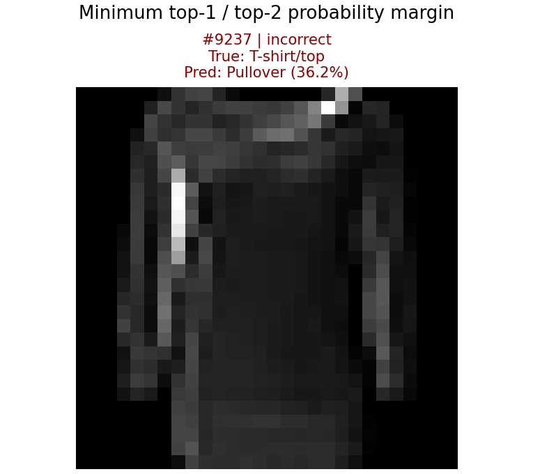

| 항목 | 값 |
| --- | --- |
| Index / 정답 | 9237 / T-shirt/top |
| Top-1 | Pullover: 36.2063% |
| Top-2 | T-shirt/top: 36.0164% |
| Margin | 0.00189877 (0.1899%p) |
| 정답 여부 | 오분류 |

이 사례는 상위 두 확률이 매우 가깝다. 원본 이미지의 긴 소매와 상의 윤곽만으로 클래스를 구분하기 어려워 보인다는 시각적 해석은 가능하지만, 선정 자체는 사람의 주관적 선택이 아니라 사전에 정한 margin 기준으로 수행했다.

[W&B 테스트 평가 run](https://wandb.ai/existenceone-korea-university-of-technology-and-education/cnn_fashion_mnist/runs/r6pezlte)

재현 기록: 체크포인트 SHA-256 16b13ceb3aa305856342a085317844dea70041259807758b3b5abeb1a5074c56

남은 과제는 최종 모델의 최소 두 기법 ablation, 입력 정규화 유무 비교와 작성자 본인의 숙제 후기다. 테스트 결과를 본 뒤 모델이나 시드를 다시 선택하지 않았다.

## E01. cnn 학습 곡선

batch=128, LR=0.001, WD=0.0001, BN=1, Dropout=0.5, augmentation=False, seed=42

저장 모델 검증 정확도 89.58%, 총 65 epoch, 0.7분, 최대 GPU 할당 메모리 209 MiB.

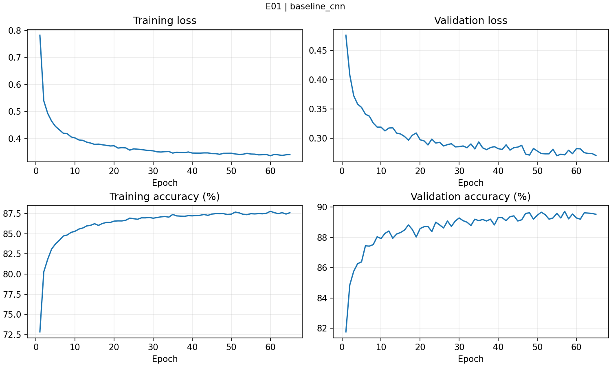

[W&B run: 5jx5co3u](https://wandb.ai/existenceone-korea-university-of-technology-and-education/cnn_fashion_mnist/runs/5jx5co3u)

baseline_cnn

## E02. googlenet 학습 곡선

batch=128, LR=0.001, WD=0.0001, BN=0, Dropout=0.5, augmentation=False, seed=42

저장 모델 검증 정확도 90.02%, 총 19 epoch, 4.4분, 최대 GPU 할당 메모리 418 MiB.

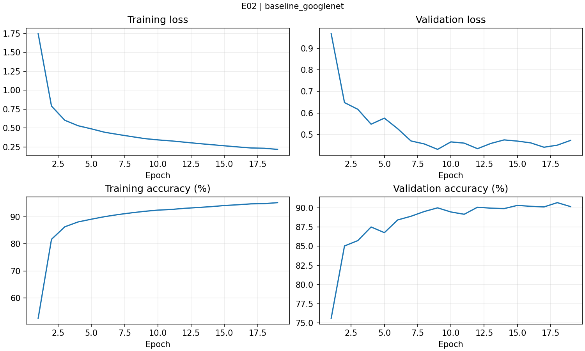

[W&B run: d9yyna63](https://wandb.ai/existenceone-korea-university-of-technology-and-education/cnn_fashion_mnist/runs/d9yyna63)

baseline_googlenet

## E03. nin 학습 곡선

batch=128, LR=0.001, WD=0.0001, BN=0, Dropout=0.5, augmentation=False, seed=42

저장 모델 검증 정확도 91.40%, 총 39 epoch, 7.5분, 최대 GPU 할당 메모리 458 MiB.

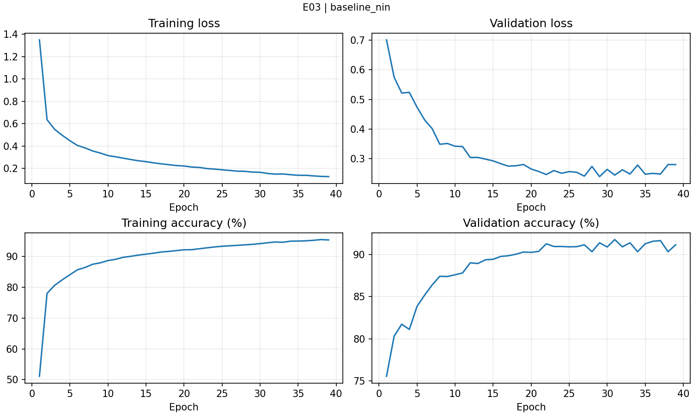

[W&B run: qww2imrf](https://wandb.ai/existenceone-korea-university-of-technology-and-education/cnn_fashion_mnist/runs/qww2imrf)

baseline_nin

## E04. resnet 학습 곡선

batch=128, LR=0.001, WD=0.0001, BN=1, Dropout=0, augmentation=False, seed=42

저장 모델 검증 정확도 90.52%, 총 18 epoch, 1.9분, 최대 GPU 할당 메모리 427 MiB.

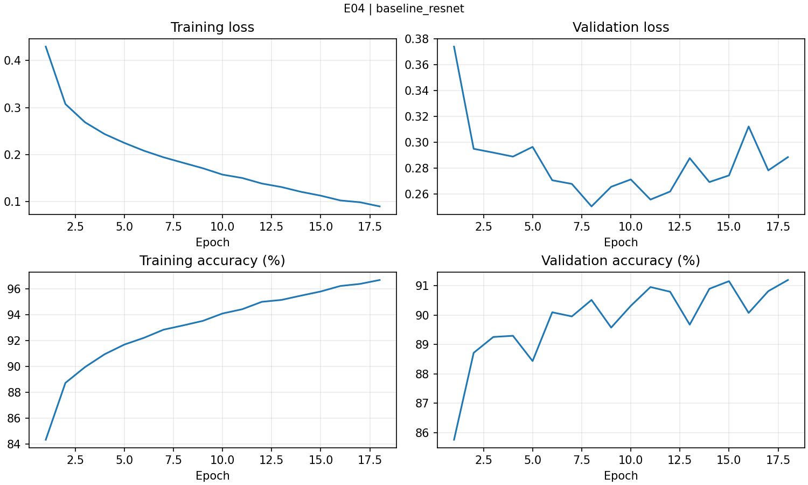

[W&B run: 5nf4jdq4](https://wandb.ai/existenceone-korea-university-of-technology-and-education/cnn_fashion_mnist/runs/5nf4jdq4)

baseline_resnet

## E05. vgg 학습 곡선

batch=128, LR=0.001, WD=0.0001, BN=0, Dropout=0.5, augmentation=False, seed=42

저장 모델 검증 정확도 91.88%, 총 24 epoch, 4.5분, 최대 GPU 할당 메모리 483 MiB.

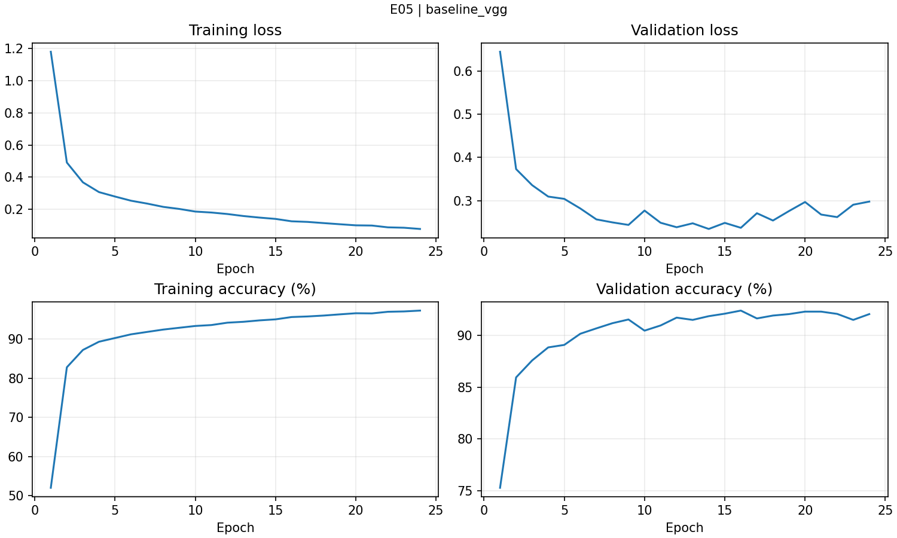

[W&B run: qzq04czt](https://wandb.ai/existenceone-korea-university-of-technology-and-education/cnn_fashion_mnist/runs/qzq04czt)

baseline_vgg

## E06. nin 학습 곡선

batch=64, LR=0.0003, WD=0.0001, BN=0, Dropout=0.5, augmentation=False, seed=42

저장 모델 검증 정확도 90.30%, 총 34 epoch, 7.0분, 최대 GPU 할당 메모리 331 MiB.

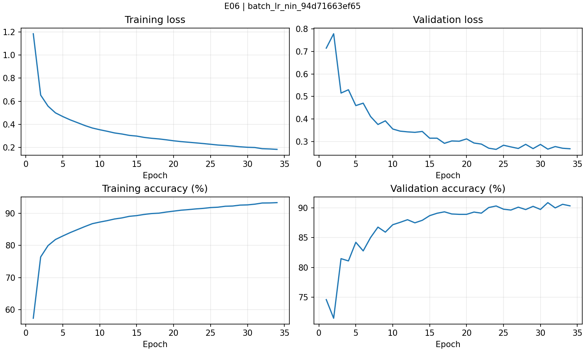

[W&B run: wxovq9ef](https://wandb.ai/existenceone-korea-university-of-technology-and-education/cnn_fashion_mnist/runs/wxovq9ef)

batch_lr_nin_94d71663ef65

## E07. nin 학습 곡선

batch=64, LR=0.001, WD=0.0001, BN=0, Dropout=0.5, augmentation=False, seed=42

저장 모델 검증 정확도 91.18%, 총 45 epoch, 9.3분, 최대 GPU 할당 메모리 331 MiB.

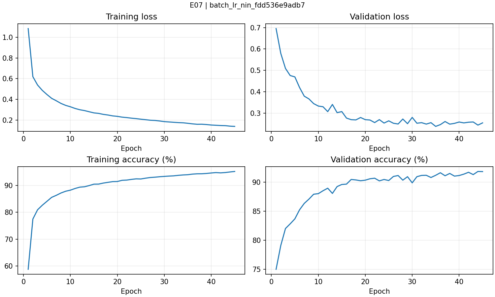

[W&B run: lpjwncuy](https://wandb.ai/existenceone-korea-university-of-technology-and-education/cnn_fashion_mnist/runs/lpjwncuy)

batch_lr_nin_fdd536e9adb7

## E08. nin 학습 곡선

batch=64, LR=0.003, WD=0.0001, BN=0, Dropout=0.5, augmentation=False, seed=42

저장 모델 검증 정확도 10.96%, 총 11 epoch, 2.3분, 최대 GPU 할당 메모리 331 MiB.

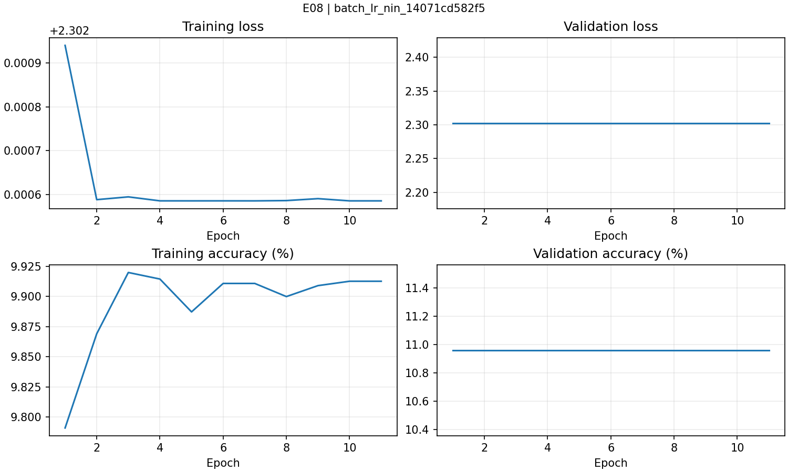

[W&B run: y0xbtrlb](https://wandb.ai/existenceone-korea-university-of-technology-and-education/cnn_fashion_mnist/runs/y0xbtrlb)

batch_lr_nin_14071cd582f5

## E09. nin 학습 곡선

batch=128, LR=0.0003, WD=0.0001, BN=0, Dropout=0.5, augmentation=False, seed=42

저장 모델 검증 정확도 90.86%, 총 50 epoch, 9.4분, 최대 GPU 할당 메모리 458 MiB.

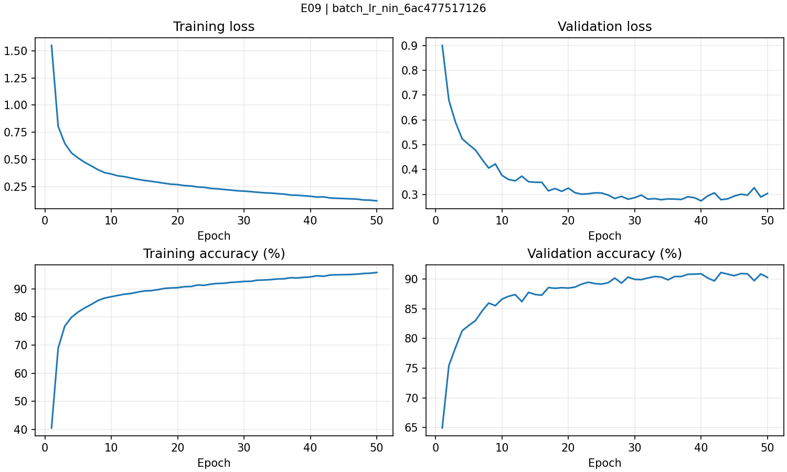

[W&B run: iujhdy45](https://wandb.ai/existenceone-korea-university-of-technology-and-education/cnn_fashion_mnist/runs/iujhdy45)

batch_lr_nin_6ac477517126

## E10. nin 학습 곡선

batch=128, LR=0.003, WD=0.0001, BN=0, Dropout=0.5, augmentation=False, seed=42

저장 모델 검증 정확도 10.96%, 총 11 epoch, 2.1분, 최대 GPU 할당 메모리 458 MiB.

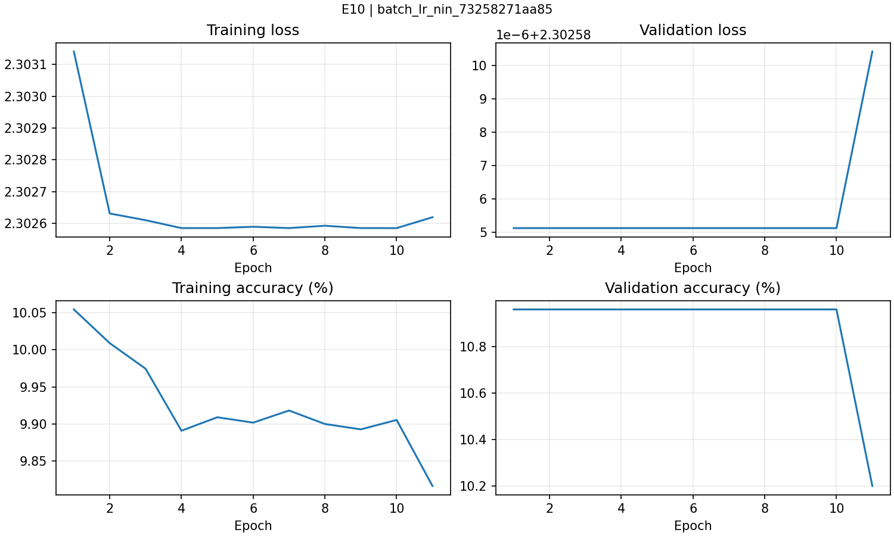

[W&B run: 33b6ldeg](https://wandb.ai/existenceone-korea-university-of-technology-and-education/cnn_fashion_mnist/runs/33b6ldeg)

batch_lr_nin_73258271aa85

## E11. nin 학습 곡선

batch=256, LR=0.0003, WD=0.0001, BN=0, Dropout=0.5, augmentation=False, seed=42

저장 모델 검증 정확도 90.22%, 총 56 epoch, 9.8분, 최대 GPU 할당 메모리 708 MiB.

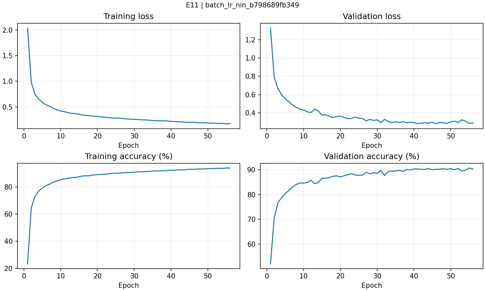

[W&B run: 9pt4fk5h](https://wandb.ai/existenceone-korea-university-of-technology-and-education/cnn_fashion_mnist/runs/9pt4fk5h)

batch_lr_nin_b798689fb349

## E12. nin 학습 곡선

batch=256, LR=0.001, WD=0.0001, BN=0, Dropout=0.5, augmentation=False, seed=42

저장 모델 검증 정확도 90.98%, 총 36 epoch, 6.3분, 최대 GPU 할당 메모리 708 MiB.

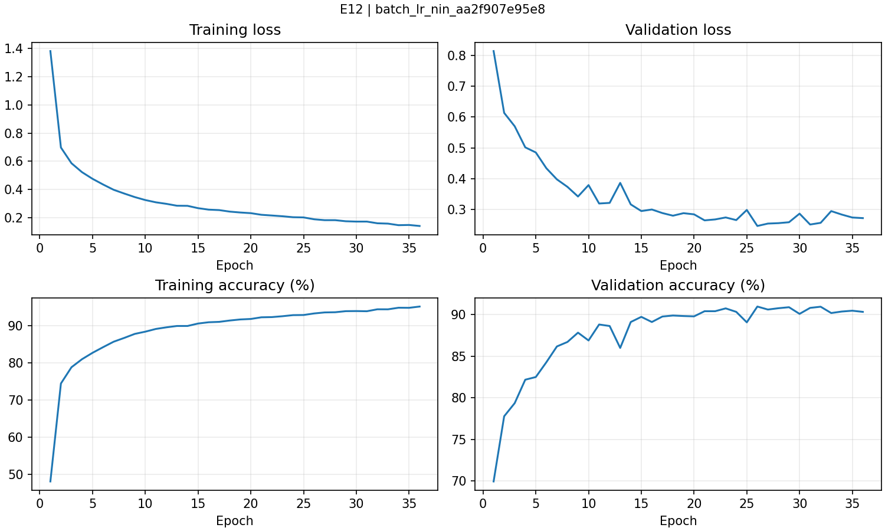

[W&B run: oezfpb1i](https://wandb.ai/existenceone-korea-university-of-technology-and-education/cnn_fashion_mnist/runs/oezfpb1i)

batch_lr_nin_aa2f907e95e8

## E13. nin 학습 곡선

batch=256, LR=0.003, WD=0.0001, BN=0, Dropout=0.5, augmentation=False, seed=42

저장 모델 검증 정확도 91.20%, 총 51 epoch, 8.9분, 최대 GPU 할당 메모리 708 MiB.

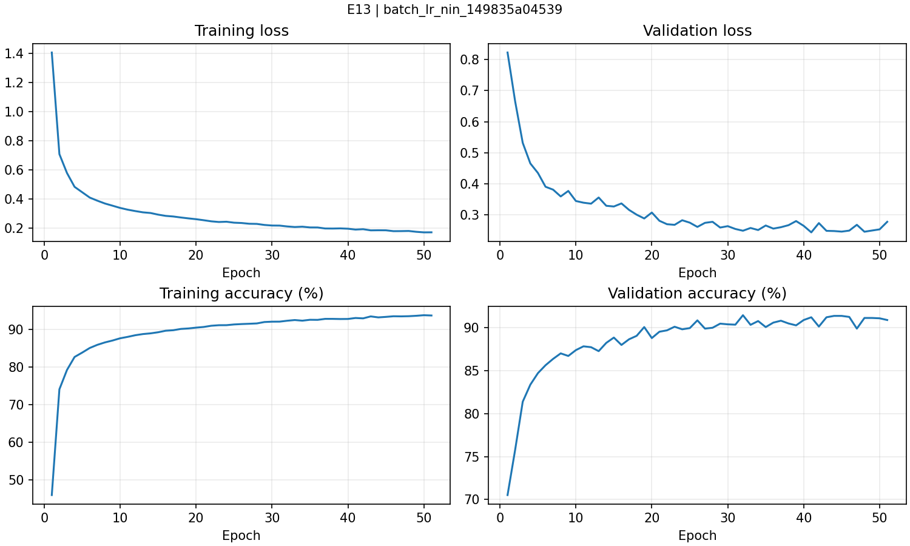

[W&B run: bto4prcc](https://wandb.ai/existenceone-korea-university-of-technology-and-education/cnn_fashion_mnist/runs/bto4prcc)

batch_lr_nin_149835a04539

## E14. vgg 학습 곡선

batch=64, LR=0.0003, WD=0.0001, BN=0, Dropout=0.5, augmentation=False, seed=42

저장 모델 검증 정확도 91.98%, 총 18 epoch, 4.0분, 최대 GPU 할당 메모리 422 MiB.

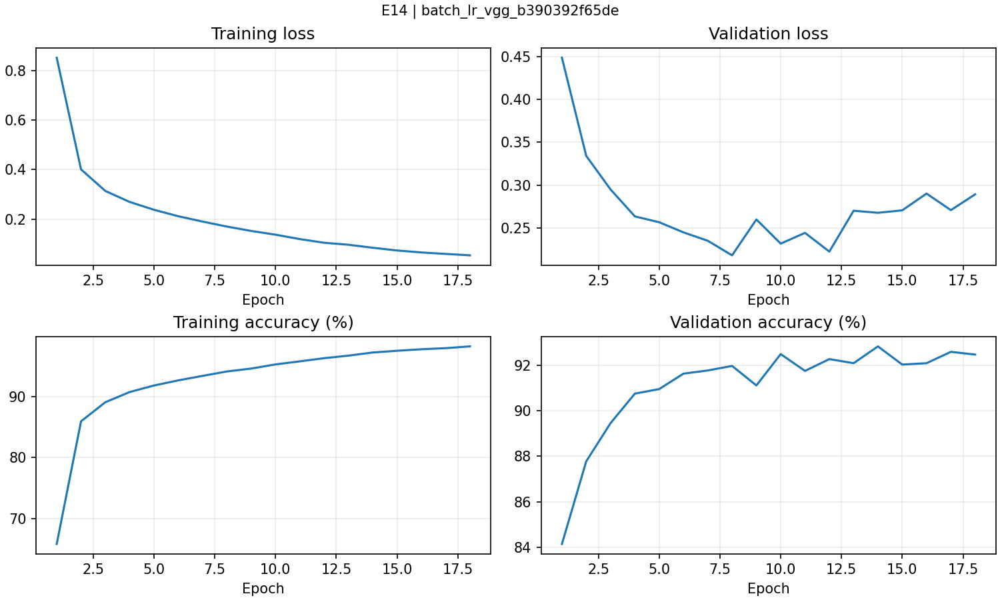

[W&B run: soutc8bx](https://wandb.ai/existenceone-korea-university-of-technology-and-education/cnn_fashion_mnist/runs/soutc8bx)

batch_lr_vgg_b390392f65de

## E15. vgg 학습 곡선

batch=64, LR=0.001, WD=0.0001, BN=0, Dropout=0.5, augmentation=False, seed=42

저장 모델 검증 정확도 91.32%, 총 25 epoch, 5.6분, 최대 GPU 할당 메모리 422 MiB.

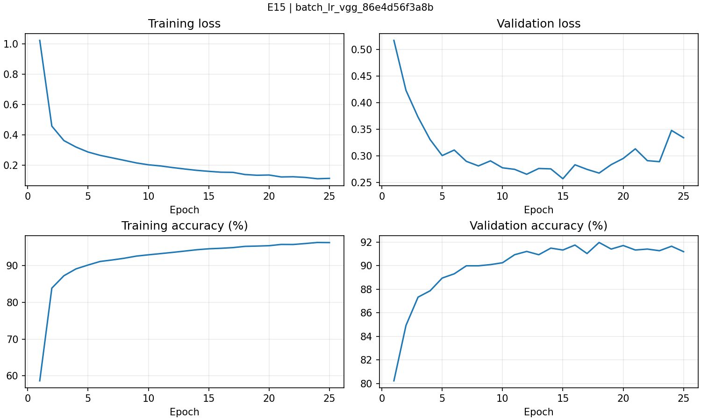

[W&B run: izflbaak](https://wandb.ai/existenceone-korea-university-of-technology-and-education/cnn_fashion_mnist/runs/izflbaak)

batch_lr_vgg_86e4d56f3a8b

## E16. vgg 학습 곡선

batch=64, LR=0.003, WD=0.0001, BN=0, Dropout=0.5, augmentation=False, seed=42

저장 모델 검증 정확도 10.18%, 총 18 epoch, 4.0분, 최대 GPU 할당 메모리 422 MiB.

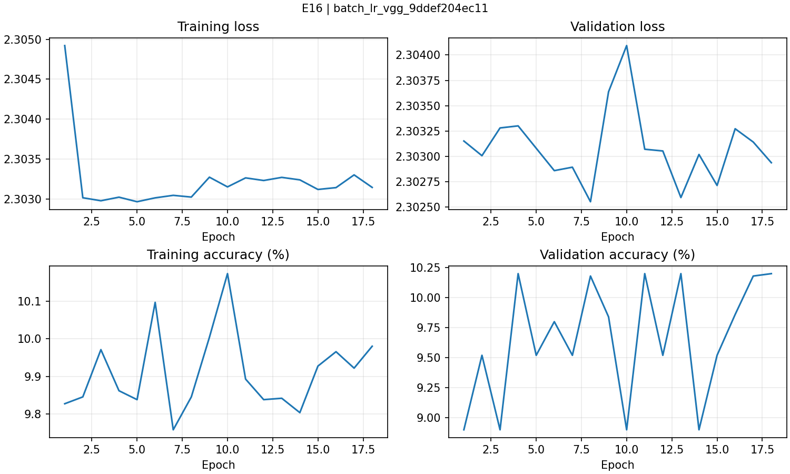

[W&B run: 9l8zcd4b](https://wandb.ai/existenceone-korea-university-of-technology-and-education/cnn_fashion_mnist/runs/9l8zcd4b)

batch_lr_vgg_9ddef204ec11

## E17. vgg 학습 곡선

batch=128, LR=0.0003, WD=0.0001, BN=0, Dropout=0.5, augmentation=False, seed=42

저장 모델 검증 정확도 91.96%, 총 18 epoch, 3.2분, 최대 GPU 할당 메모리 483 MiB.

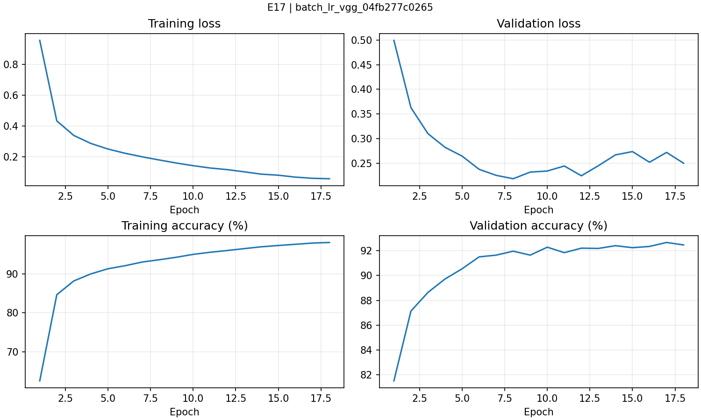

[W&B run: tqs5157y](https://wandb.ai/existenceone-korea-university-of-technology-and-education/cnn_fashion_mnist/runs/tqs5157y)

batch_lr_vgg_04fb277c0265

## E18. vgg 학습 곡선

batch=128, LR=0.003, WD=0.0001, BN=0, Dropout=0.5, augmentation=False, seed=42

저장 모델 검증 정확도 91.22%, 총 37 epoch, 6.5분, 최대 GPU 할당 메모리 483 MiB.

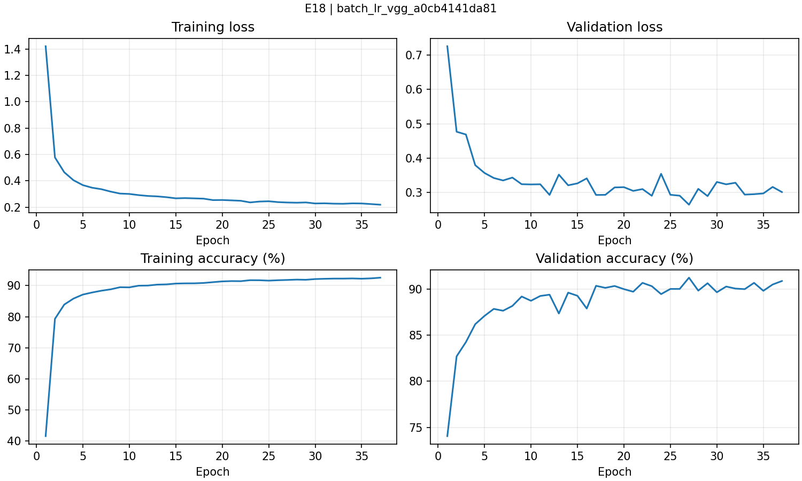

[W&B run: eph8hgal](https://wandb.ai/existenceone-korea-university-of-technology-and-education/cnn_fashion_mnist/runs/eph8hgal)

batch_lr_vgg_a0cb4141da81

## E19. vgg 학습 곡선

batch=256, LR=0.0003, WD=0.0001, BN=0, Dropout=0.5, augmentation=False, seed=42

저장 모델 검증 정확도 92.12%, 총 22 epoch, 3.3분, 최대 GPU 할당 메모리 605 MiB.

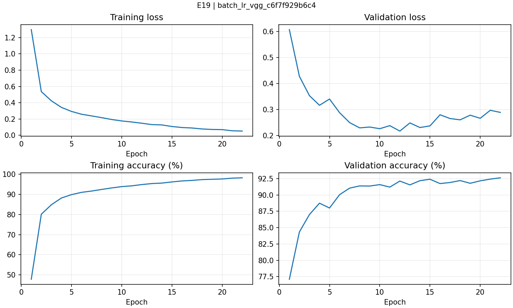

[W&B run: l1wds0qm](https://wandb.ai/existenceone-korea-university-of-technology-and-education/cnn_fashion_mnist/runs/l1wds0qm)

batch_lr_vgg_c6f7f929b6c4

## E20. vgg 학습 곡선

batch=256, LR=0.001, WD=0.0001, BN=0, Dropout=0.5, augmentation=False, seed=42

저장 모델 검증 정확도 92.38%, 총 22 epoch, 3.3분, 최대 GPU 할당 메모리 605 MiB.

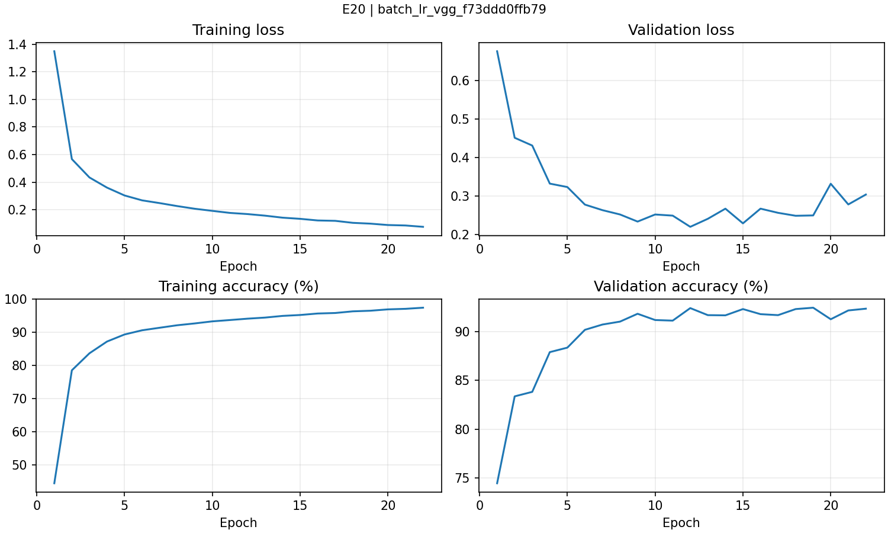

[W&B run: soo8ky91](https://wandb.ai/existenceone-korea-university-of-technology-and-education/cnn_fashion_mnist/runs/soo8ky91)

batch_lr_vgg_f73ddd0ffb79

## E21. vgg 학습 곡선

batch=256, LR=0.003, WD=0.0001, BN=0, Dropout=0.5, augmentation=False, seed=42

저장 모델 검증 정확도 10.20%, 총 23 epoch, 3.5분, 최대 GPU 할당 메모리 605 MiB.

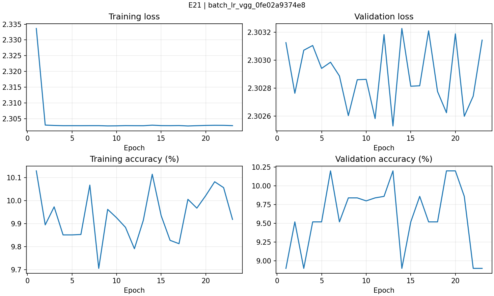

[W&B run: 6q1qpj0p](https://wandb.ai/existenceone-korea-university-of-technology-and-education/cnn_fashion_mnist/runs/6q1qpj0p)

batch_lr_vgg_0fe02a9374e8

## E22. nin 학습 곡선

batch=256, LR=0.0003, WD=0.0, BN=1, Dropout=0.5, augmentation=True, seed=42

저장 모델 검증 정확도 93.34%, 총 34 epoch, 8.0분, 최대 GPU 할당 메모리 1085 MiB.

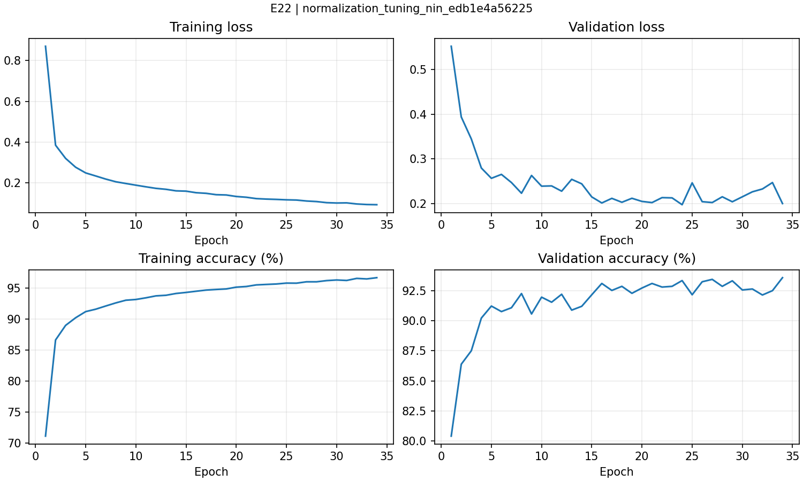

[W&B run: 1ruzkloa](https://wandb.ai/existenceone-korea-university-of-technology-and-education/cnn_fashion_mnist/runs/1ruzkloa)

normalization_tuning_nin_edb1e4a56225

## E23. nin 학습 곡선

batch=256, LR=0.001, WD=0.0, BN=1, Dropout=0.5, augmentation=True, seed=42

저장 모델 검증 정확도 93.32%, 총 32 epoch, 7.6분, 최대 GPU 할당 메모리 1085 MiB.

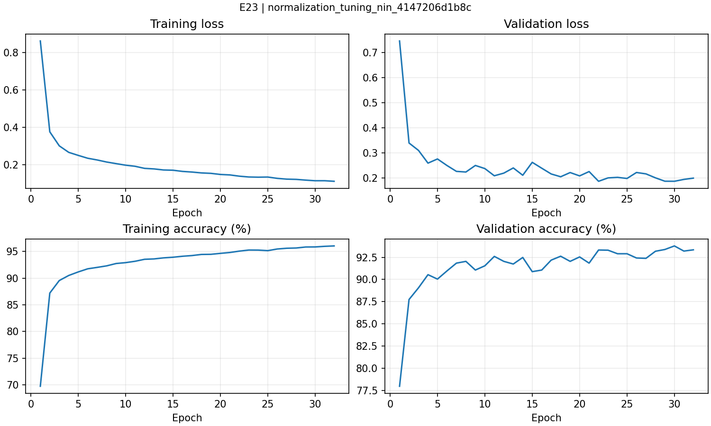

[W&B run: 1n3nwov9](https://wandb.ai/existenceone-korea-university-of-technology-and-education/cnn_fashion_mnist/runs/1n3nwov9)

normalization_tuning_nin_4147206d1b8c

## E24. nin 학습 곡선

batch=256, LR=0.003, WD=0.0, BN=1, Dropout=0.5, augmentation=True, seed=42

저장 모델 검증 정확도 93.98%, 총 40 epoch, 9.5분, 최대 GPU 할당 메모리 1085 MiB.

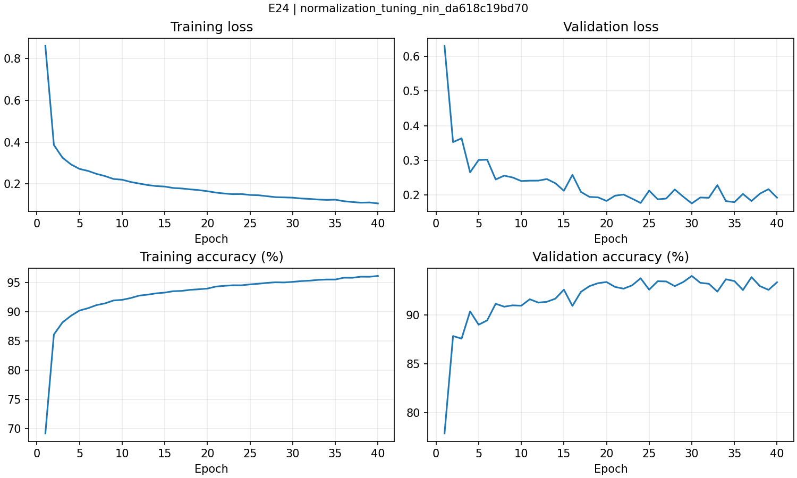

[W&B run: ifjwdgt6](https://wandb.ai/existenceone-korea-university-of-technology-and-education/cnn_fashion_mnist/runs/ifjwdgt6)

normalization_tuning_nin_da618c19bd70

## E25. vgg 학습 곡선

batch=256, LR=0.0003, WD=0.0001, BN=1, Dropout=0, augmentation=True, seed=42

저장 모델 검증 정확도 94.06%, 총 35 epoch, 6.2분, 최대 GPU 할당 메모리 751 MiB.

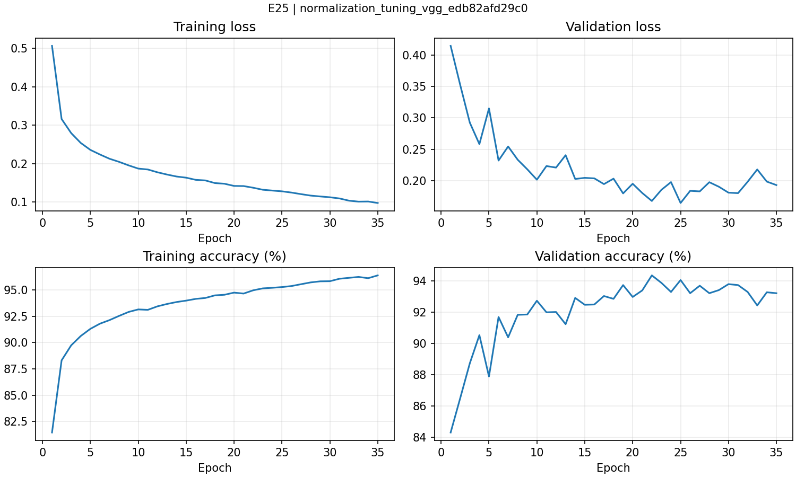

[W&B run: ab8xs9b6](https://wandb.ai/existenceone-korea-university-of-technology-and-education/cnn_fashion_mnist/runs/ab8xs9b6)

normalization_tuning_vgg_edb82afd29c0

## E26. vgg 학습 곡선

batch=256, LR=0.001, WD=0.0001, BN=1, Dropout=0, augmentation=True, seed=42

저장 모델 검증 정확도 93.78%, 총 44 epoch, 7.7분, 최대 GPU 할당 메모리 751 MiB.

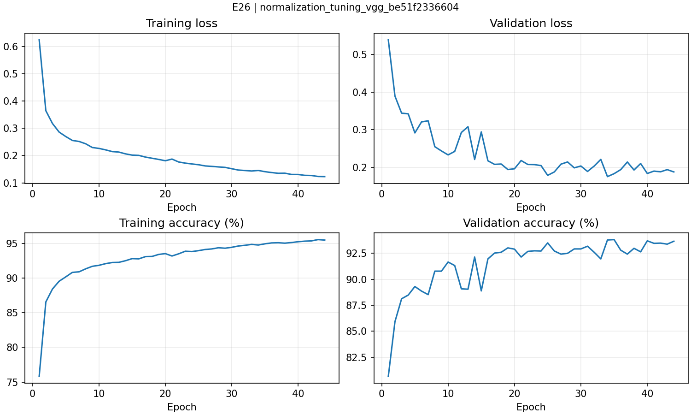

[W&B run: c8ffnosk](https://wandb.ai/existenceone-korea-university-of-technology-and-education/cnn_fashion_mnist/runs/c8ffnosk)

normalization_tuning_vgg_be51f2336604

## E27. nin 학습 곡선

batch=256, LR=0.003, WD=0.0, BN=0, Dropout=0, augmentation=False, seed=42

저장 모델 검증 정확도 90.80%, 총 25 epoch, 4.4분, 최대 GPU 할당 메모리 708 MiB.

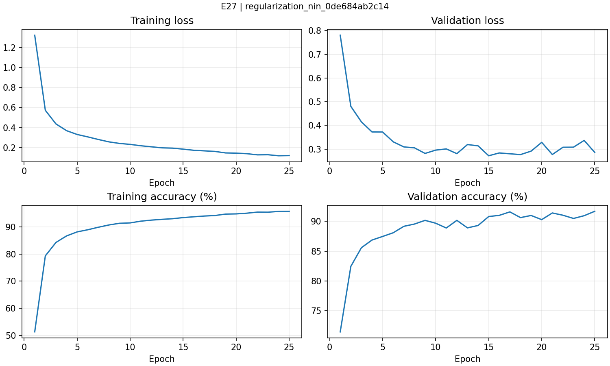

[W&B run: c98xmy56](https://wandb.ai/existenceone-korea-university-of-technology-and-education/cnn_fashion_mnist/runs/c98xmy56)

regularization_nin_0de684ab2c14

## E28. nin 학습 곡선

batch=256, LR=0.003, WD=0.0, BN=0, Dropout=0.5, augmentation=True, seed=42

저장 모델 검증 정확도 92.08%, 총 71 epoch, 12.7분, 최대 GPU 할당 메모리 708 MiB.

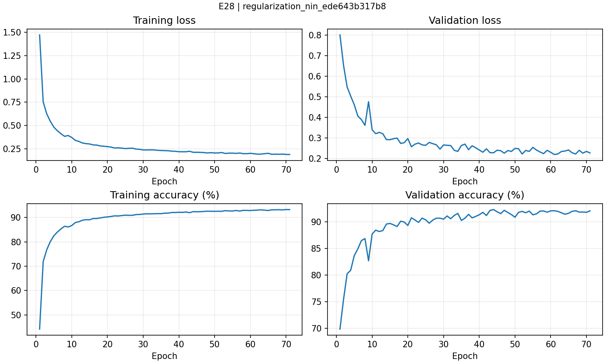

[W&B run: xxawt4uq](https://wandb.ai/existenceone-korea-university-of-technology-and-education/cnn_fashion_mnist/runs/xxawt4uq)

regularization_nin_ede643b317b8

## E29. nin 학습 곡선

batch=256, LR=0.003, WD=0.0, BN=0, Dropout=0, augmentation=True, seed=42

저장 모델 검증 정확도 91.94%, 총 47 epoch, 8.4분, 최대 GPU 할당 메모리 708 MiB.

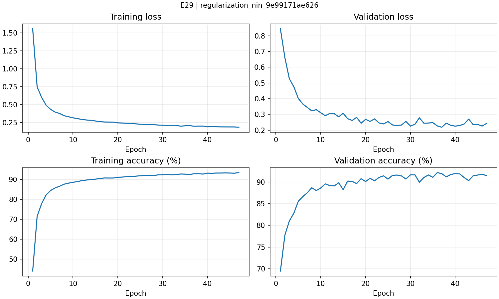

[W&B run: oqyj3cvw](https://wandb.ai/existenceone-korea-university-of-technology-and-education/cnn_fashion_mnist/runs/oqyj3cvw)

regularization_nin_9e99171ae626

## E30. nin 학습 곡선

batch=256, LR=0.003, WD=0.0, BN=0, Dropout=0.2, augmentation=False, seed=42

저장 모델 검증 정확도 91.26%, 총 28 epoch, 4.9분, 최대 GPU 할당 메모리 708 MiB.

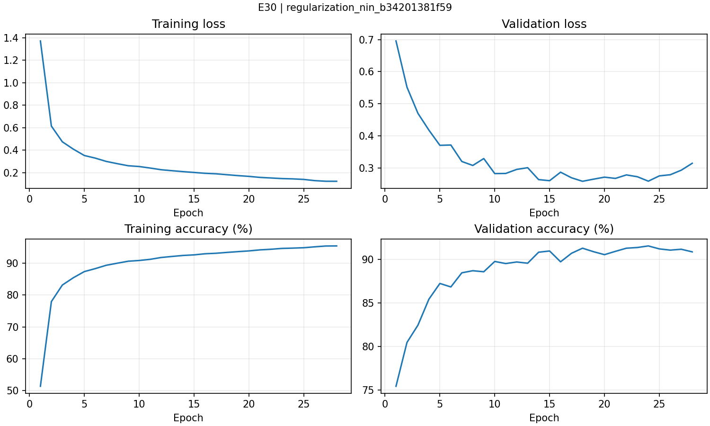

[W&B run: rfsr1dti](https://wandb.ai/existenceone-korea-university-of-technology-and-education/cnn_fashion_mnist/runs/rfsr1dti)

regularization_nin_b34201381f59

## E31. nin 학습 곡선

batch=256, LR=0.003, WD=0.0, BN=0, Dropout=0.2, augmentation=True, seed=42

저장 모델 검증 정확도 90.92%, 총 48 epoch, 8.6분, 최대 GPU 할당 메모리 708 MiB.

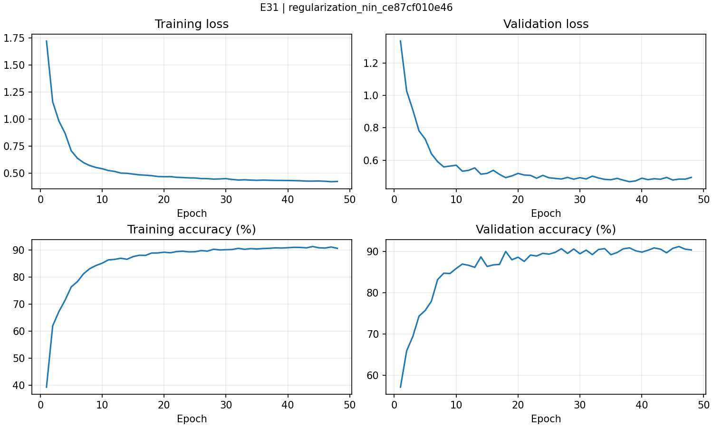

[W&B run: 3v65ms9f](https://wandb.ai/existenceone-korea-university-of-technology-and-education/cnn_fashion_mnist/runs/3v65ms9f)

regularization_nin_ce87cf010e46

## E32. vgg 학습 곡선

batch=256, LR=0.001, WD=0.0001, BN=0, Dropout=0.2, augmentation=False, seed=42

저장 모델 검증 정확도 91.82%, 총 18 epoch, 2.8분, 최대 GPU 할당 메모리 605 MiB.

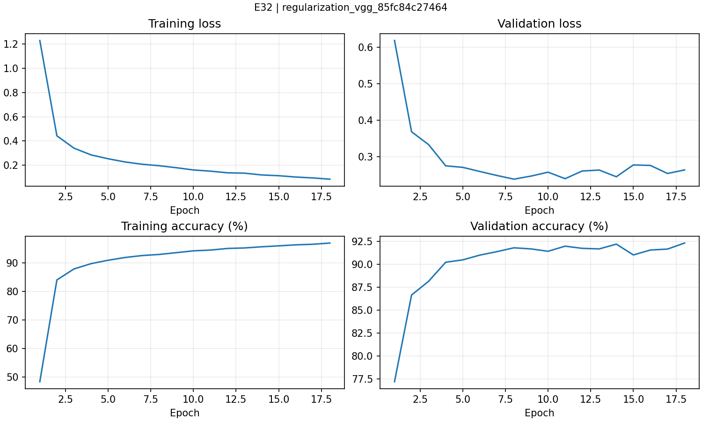

[W&B run: 78qjgvj1](https://wandb.ai/existenceone-korea-university-of-technology-and-education/cnn_fashion_mnist/runs/78qjgvj1)

regularization_vgg_85fc84c27464

## E33. vgg 학습 곡선

batch=256, LR=0.001, WD=0.0001, BN=0, Dropout=0.5, augmentation=True, seed=42

저장 모델 검증 정확도 92.64%, 총 35 epoch, 5.4분, 최대 GPU 할당 메모리 605 MiB.

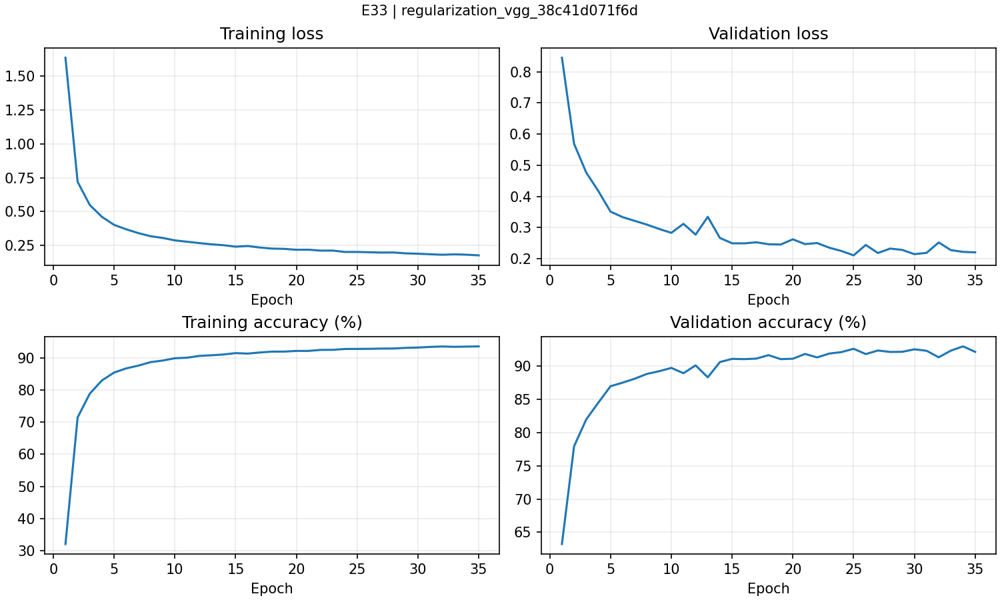

[W&B run: bmuwf6n8](https://wandb.ai/existenceone-korea-university-of-technology-and-education/cnn_fashion_mnist/runs/bmuwf6n8)

regularization_vgg_38c41d071f6d

## E34. vgg 학습 곡선

batch=256, LR=0.001, WD=0.0001, BN=0, Dropout=0, augmentation=False, seed=42

저장 모델 검증 정확도 92.12%, 총 22 epoch, 3.3분, 최대 GPU 할당 메모리 605 MiB.

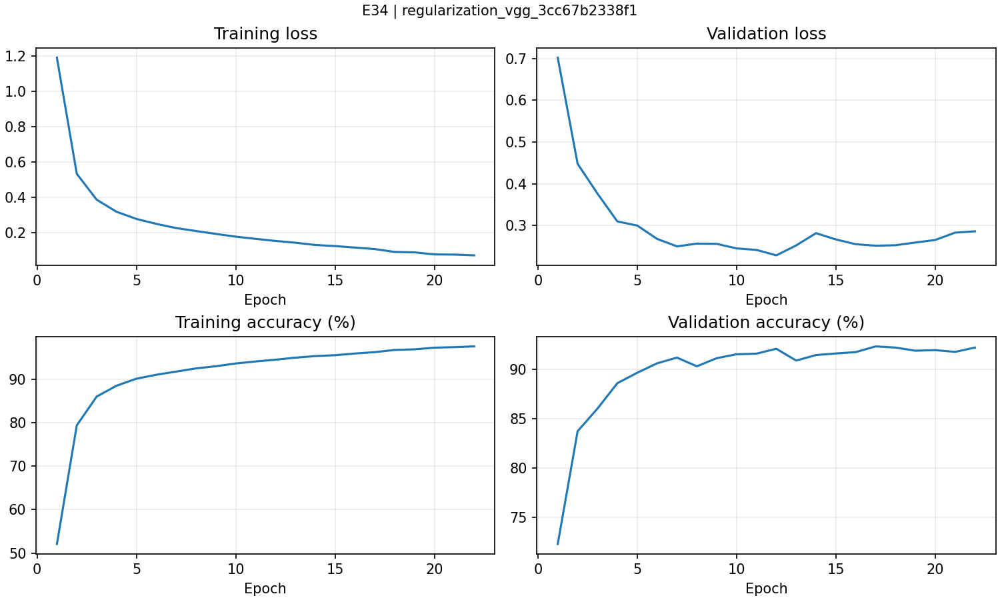

[W&B run: ytx4b8us](https://wandb.ai/existenceone-korea-university-of-technology-and-education/cnn_fashion_mnist/runs/ytx4b8us)

regularization_vgg_3cc67b2338f1

## E35. vgg 학습 곡선

batch=256, LR=0.001, WD=0.0001, BN=0, Dropout=0, augmentation=True, seed=42

저장 모델 검증 정확도 93.46%, 총 37 epoch, 5.8분, 최대 GPU 할당 메모리 605 MiB.

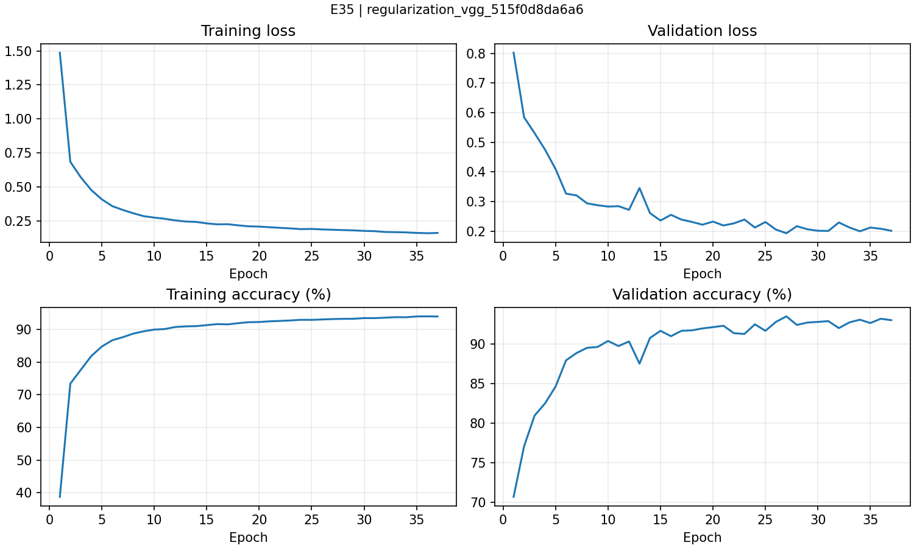

[W&B run: 8kr3bwor](https://wandb.ai/existenceone-korea-university-of-technology-and-education/cnn_fashion_mnist/runs/8kr3bwor)

regularization_vgg_515f0d8da6a6

## E36. vgg 학습 곡선

batch=256, LR=0.001, WD=0.0001, BN=0, Dropout=0.2, augmentation=True, seed=42

저장 모델 검증 정확도 93.16%, 총 46 epoch, 7.1분, 최대 GPU 할당 메모리 605 MiB.

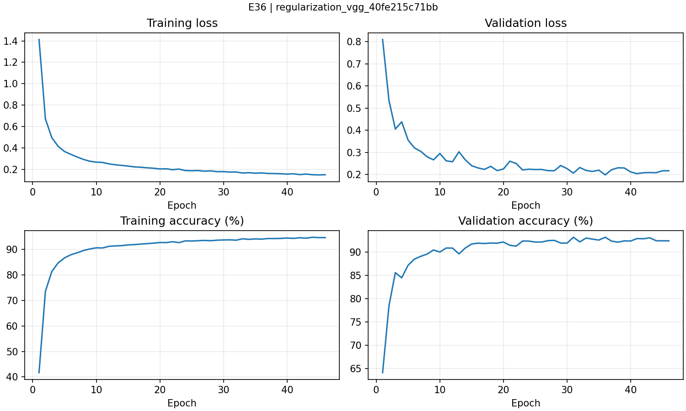

[W&B run: zz4s7pra](https://wandb.ai/existenceone-korea-university-of-technology-and-education/cnn_fashion_mnist/runs/zz4s7pra)

regularization_vgg_40fe215c71bb

## E37. nin 학습 곡선

batch=256, LR=0.003, WD=0.0, BN=1, Dropout=0.5, augmentation=True, seed=43

저장 모델 검증 정확도 94.06%, 총 43 epoch, 10.2분, 최대 GPU 할당 메모리 1085 MiB.

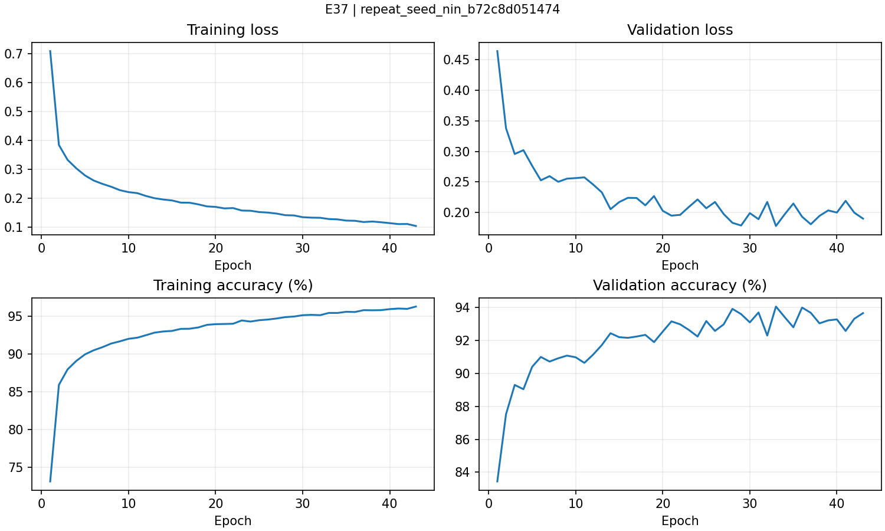

[W&B run: mcz7xtiq](https://wandb.ai/existenceone-korea-university-of-technology-and-education/cnn_fashion_mnist/runs/mcz7xtiq)

repeat_seed_nin_b72c8d051474

## E38. nin 학습 곡선

batch=256, LR=0.003, WD=0.0, BN=1, Dropout=0.5, augmentation=True, seed=44

저장 모델 검증 정확도 85.46%, 총 42 epoch, 9.9분, 최대 GPU 할당 메모리 1085 MiB.

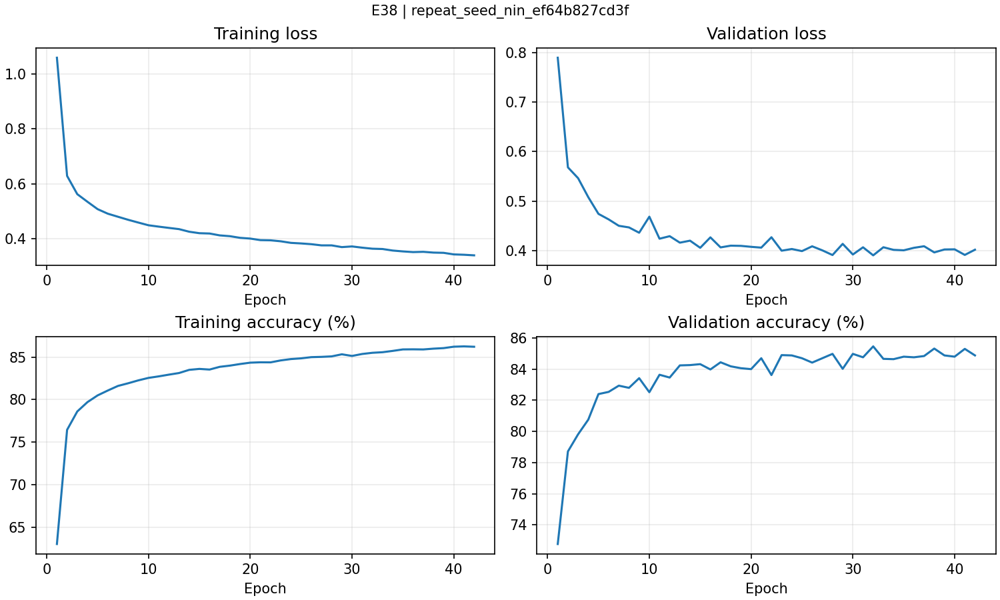

[W&B run: rof2e34m](https://wandb.ai/existenceone-korea-university-of-technology-and-education/cnn_fashion_mnist/runs/rof2e34m)

repeat_seed_nin_ef64b827cd3f

## E39. vgg 학습 곡선

batch=256, LR=0.0003, WD=0.0001, BN=1, Dropout=0, augmentation=True, seed=43

저장 모델 검증 정확도 93.96%, 총 40 epoch, 7.0분, 최대 GPU 할당 메모리 751 MiB.

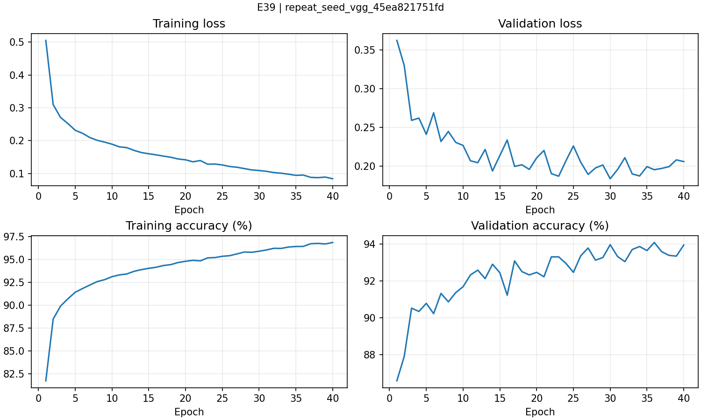

[W&B run: pig8ruzl](https://wandb.ai/existenceone-korea-university-of-technology-and-education/cnn_fashion_mnist/runs/pig8ruzl)

repeat_seed_vgg_45ea821751fd

## E40. vgg 학습 곡선

batch=256, LR=0.0003, WD=0.0001, BN=1, Dropout=0, augmentation=True, seed=44

저장 모델 검증 정확도 93.28%, 총 30 epoch, 5.3분, 최대 GPU 할당 메모리 751 MiB.

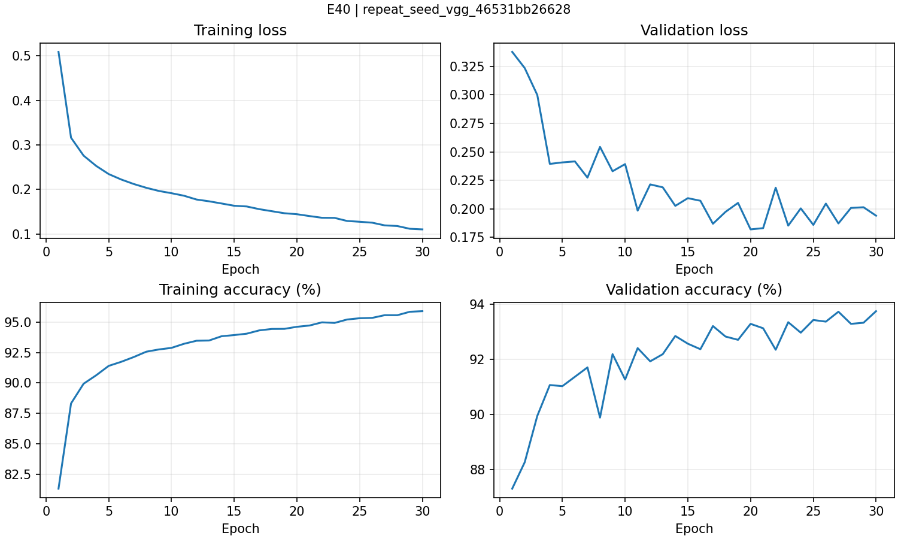

[W&B run: g7xf1v21](https://wandb.ai/existenceone-korea-university-of-technology-and-education/cnn_fashion_mnist/runs/g7xf1v21)

repeat_seed_vgg_46531bb26628

## E41. nin 학습 곡선

batch=128, LR=0.001, WD=0.0, BN=0, Dropout=0.5, augmentation=False, seed=42

저장 모델 검증 정확도 91.82%, 총 27 epoch, 5.1분, 최대 GPU 할당 메모리 458 MiB.

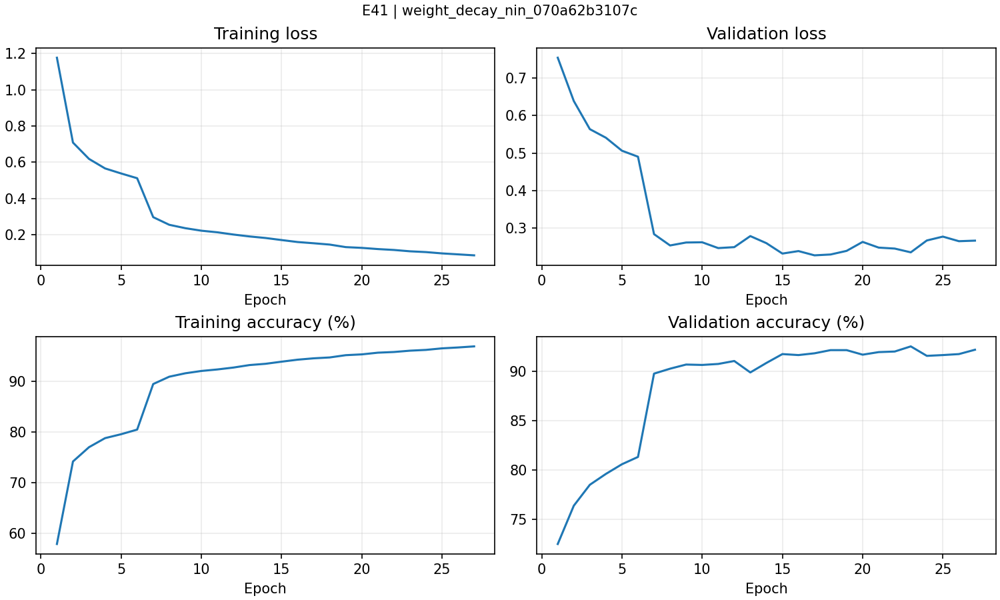

[W&B run: 8qp8vww2](https://wandb.ai/existenceone-korea-university-of-technology-and-education/cnn_fashion_mnist/runs/8qp8vww2)

weight_decay_nin_070a62b3107c

## E42. nin 학습 곡선

batch=128, LR=0.001, WD=0.001, BN=0, Dropout=0.5, augmentation=False, seed=42

저장 모델 검증 정확도 9.86%, 총 15 epoch, 2.8분, 최대 GPU 할당 메모리 458 MiB.

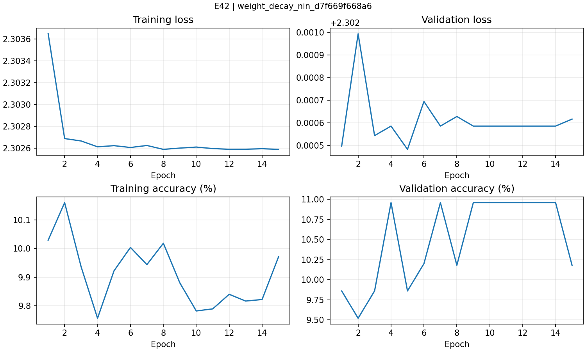

[W&B run: 7jml8gei](https://wandb.ai/existenceone-korea-university-of-technology-and-education/cnn_fashion_mnist/runs/7jml8gei)

weight_decay_nin_d7f669f668a6

## E43. nin 학습 곡선

batch=256, LR=0.003, WD=0.001, BN=0, Dropout=0.5, augmentation=False, seed=42

저장 모델 검증 정확도 9.52%, 총 11 epoch, 2.0분, 최대 GPU 할당 메모리 708 MiB.

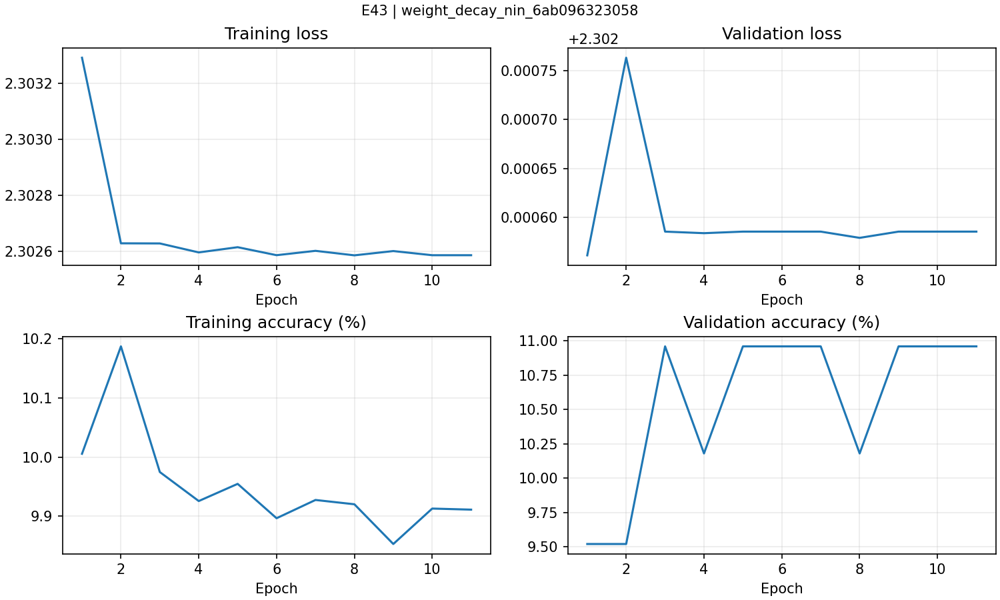

[W&B run: lpnug33f](https://wandb.ai/existenceone-korea-university-of-technology-and-education/cnn_fashion_mnist/runs/lpnug33f)

weight_decay_nin_6ab096323058

## E44. nin 학습 곡선

batch=256, LR=0.003, WD=0.0, BN=0, Dropout=0.5, augmentation=False, seed=42

저장 모델 검증 정확도 92.02%, 총 36 epoch, 6.3분, 최대 GPU 할당 메모리 708 MiB.

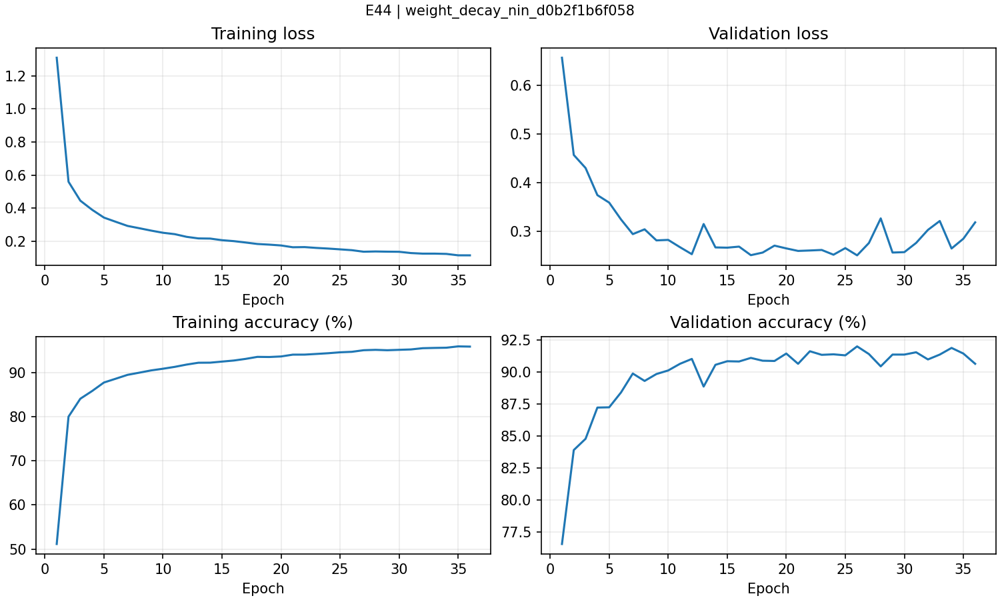

[W&B run: dj3gviey](https://wandb.ai/existenceone-korea-university-of-technology-and-education/cnn_fashion_mnist/runs/dj3gviey)

weight_decay_nin_d0b2f1b6f058

## E45. vgg 학습 곡선

batch=256, LR=0.0003, WD=0.0, BN=0, Dropout=0.5, augmentation=False, seed=42

저장 모델 검증 정확도 91.96%, 총 19 epoch, 2.8분, 최대 GPU 할당 메모리 605 MiB.

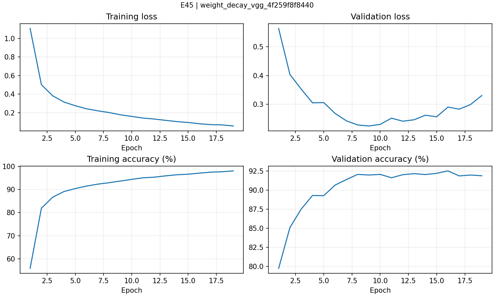

[W&B run: bj9a9a1s](https://wandb.ai/existenceone-korea-university-of-technology-and-education/cnn_fashion_mnist/runs/bj9a9a1s)

weight_decay_vgg_4f259f8f8440

## E46. vgg 학습 곡선

batch=256, LR=0.0003, WD=0.001, BN=0, Dropout=0.5, augmentation=False, seed=42

저장 모델 검증 정확도 9.52%, 총 12 epoch, 1.8분, 최대 GPU 할당 메모리 605 MiB.

[W&B run: nip6h25w](https://wandb.ai/existenceone-korea-university-of-technology-and-education/cnn_fashion_mnist/runs/nip6h25w)

weight_decay_vgg_83db9ea76375

## E47. vgg 학습 곡선

batch=256, LR=0.001, WD=0.0, BN=0, Dropout=0.5, augmentation=False, seed=42

저장 모델 검증 정확도 92.18%, 총 20 epoch, 3.0분, 최대 GPU 할당 메모리 605 MiB.

[W&B run: zxgw1pkw](https://wandb.ai/existenceone-korea-university-of-technology-and-education/cnn_fashion_mnist/runs/zxgw1pkw)

weight_decay_vgg_7fe0697cb5f1

## E48. vgg 학습 곡선

batch=256, LR=0.001, WD=0.001, BN=0, Dropout=0.5, augmentation=False, seed=42

저장 모델 검증 정확도 9.52%, 총 12 epoch, 1.8분, 최대 GPU 할당 메모리 605 MiB.

[W&B run: i1m8oj5h](https://wandb.ai/existenceone-korea-university-of-technology-and-education/cnn_fashion_mnist/runs/i1m8oj5h)

weight_decay_vgg_80f26eb88014
